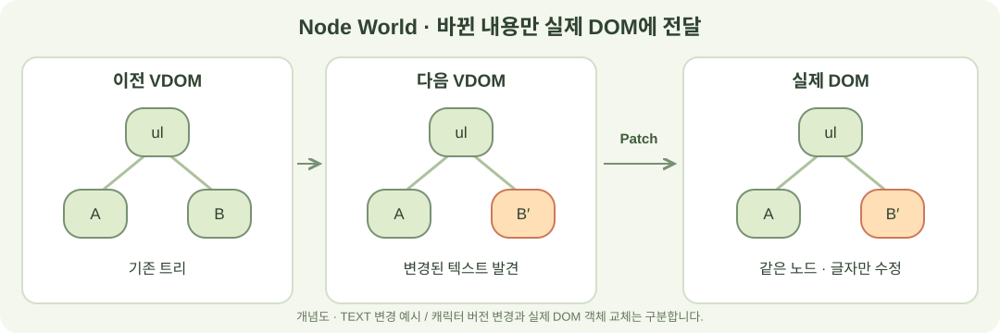
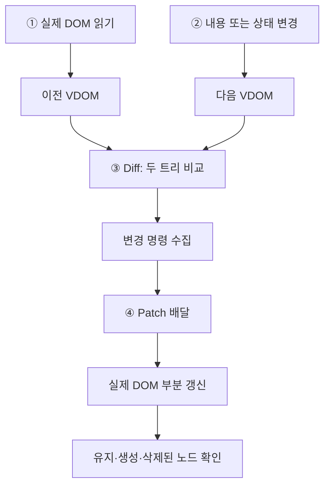
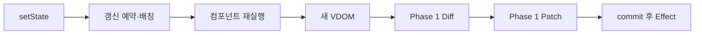
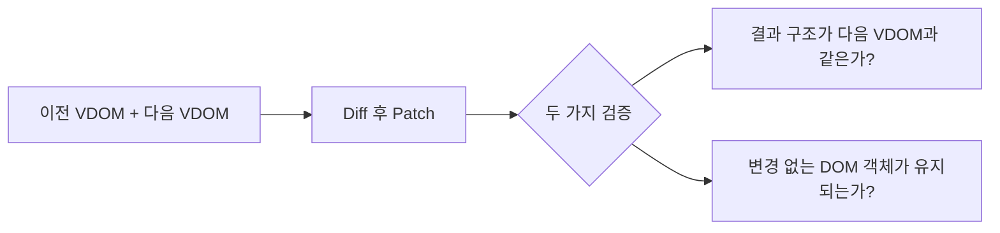

# Mini React · Node World

**화면이 바뀌는 결과부터, 바뀐 부분을 찾고 적용하는 과정까지.**

Vanilla JavaScript로 DOM·VDOM·Diff·Patch와 함수형 컴포넌트·Hooks를 구현하고, 그 흐름을 노드 캐릭터로 시각화했습니다.



현재 진입 화면은 **Node World 하나**입니다.

> 위 그림은 TEXT 변경의 개념도입니다. 실제 화면에서는 노드 캐릭터의 비교·이동과 Patch 배달을 조작할 수 있습니다.

[만든 이유](#1-왜-node-world인가) · [실행 흐름](#2-화면-안에서-실제로-일어나는-일) · [Hooks](#3-phase-2는-phase-1과-어떻게-연결되는가) · [검증](#5-무엇을-어떻게-검증했는가) · [실행](#6-직접-실행하기)

## 1. 왜 Node World인가?

**“화면이 같으면, 내부 구현도 올바른 걸까?”**

전체 DOM을 새로 만들어도 글자 하나만 수정해도 결과는 같을 수 있습니다. 결과 화면만으로 구분하기 어려워, 이전 VDOM·다음 VDOM·실제 DOM을 함께 관찰하도록 만들었습니다.

| 고민                                     | 선택한 방법                  | 확인하고 싶었던 것                     |
| ---------------------------------------- | ---------------------------- | -------------------------------------- |
| 변경 판단과 적용이 한 번에 지나간다      | Diff와 Patch를 단계로 분리   | 무엇을 바꾸기로 했고, 언제 적용되는가? |
| 캐릭터가 설명용 연출에 그칠 수 있다      | 실제 엔진의 변경 명령과 연결 | 애니메이션과 내부 동작이 대응하는가?   |
| 같은 화면이 나와도 전체 재생성일 수 있다 | DOM 객체 참조까지 검사       | 변경 없는 노드를 정말 재사용하는가?    |

## 2. 화면 안에서 실제로 일어나는 일



| 시연 조작                    | 내부 동작                 | 화면에서 볼 것                |
| ---------------------------- | ------------------------- | ----------------------------- |
| **DOM 읽기**                 | `domToVNode()`            | 실제 DOM에 대응하는 이전 트리 |
| **텍스트 변경·친구 추가 등** | 다음 VDOM 초안 생성       | 이전·다음 트리의 차이         |
| **비교 시작**                | `diff(previous, next)`    | 노드 대응과 변경 명령 수집    |
| **Patch 배달부**             | `patch(root, changes)`    | 실제 DOM 변경과 노드 재사용   |
| **State +3**                 | 상태 갱신·컴포넌트 재실행 | 배칭·Memo·Effect 기록         |

단계별 모드에서는 **비교 중에 대상 DOM이 바뀌지 않습니다.** 자동 적용 모드에서는 Diff·Patch를 바로 실행하며 캐릭터 변화로 보여줍니다. 캐릭터 이동과 대기는 학습 연출입니다.

### 캐릭터가 바뀌면 실제 DOM도 교체될까?

| 명령                | 실제 DOM 동작                | 객체 유지 여부   |
| ------------------- | ---------------------------- | ---------------- |
| `TEXT` / `PROPS`    | 글자 / 속성·이벤트 수정      | 기존 노드 유지   |
| `MOVE`              | 기존 노드의 위치 이동        | 기존 노드 유지   |
| `INSERT` / `REMOVE` | 새 노드 추가 / 대상 제거     | 나머지 노드 유지 |
| `REPLACE`           | 대상과 하위 트리를 새로 생성 | 대상 교체        |

**부모 태그가 달라지면 왜 자식은 비교하지 않을까?** 부모의 REPLACE로 하위 트리도 함께 새로 생성되므로, 기존 자식에 대한 수정 명령을 따로 만들 필요가 없습니다.

고유한 `props.key`가 이전·다음 형제 목록 모두에 있으면 key로 대응하고 이동합니다. key가 없거나 일부만 있거나 중복되면 인덱스로 비교합니다. 상단의 별도 직접 DOM 화면에서는 전체 재생성 방식도 관찰할 수 있습니다.

## 3. Phase 2는 Phase 1과 어떻게 연결되는가?



최초 mount는 DOM을 생성하고, 이후 갱신은 **같은 Diff·Patch 엔진을 재사용**합니다.

| 구현                | 저장·처리하는 것             | 핵심 동작                                 |
| ------------------- | ---------------------------- | ----------------------------------------- |
| `FunctionComponent` | Hook 슬롯·이전 VDOM·DOM 루트 | 재실행 뒤에도 상태 유지                   |
| `useState`          | 값과 setter                  | 상태 변경 시 갱신 예약, 같은 값은 생략    |
| `useMemo`           | 계산 결과와 의존성           | 같으면 재사용, 달라지면 재계산            |
| `useEffect`         | 의존성과 cleanup             | commit 후 실행, 다음 실행 전·종료 시 정리 |
| 배칭                | microtask 갱신 예약          | 여러 setter를 한 번의 갱신으로 묶음       |

> **Node World의 State +3:** 별도 Hook 런타임이 먼저 commit하고 다음 VDOM 초안을 만듭니다. 메인 대상 DOM은 별도 비교·배달 단계에서 적용됩니다. Effect 기록과 메인 화면 Patch의 시점은 구분합니다.

## 4. 구현하면서 배운 점

| 처음의 질문                         | 구현·검증을 통해 정리한 내용                                                 |
| ----------------------------------- | ---------------------------------------------------------------------------- |
| 결과 HTML만 같으면 충분할까?        | 최종 구조와 DOM 객체의 동일성을 함께 확인해야 부분 갱신을 증명할 수 있다.    |
| Diff는 모든 자식을 끝까지 비교할까? | 부모 교체가 결정되면 하위 비교를 종료할 수 있다.                             |
| Hook은 값을 반환하는 함수일까?      | 재실행 사이의 저장 공간, 의존성, commit·cleanup 순서를 함께 설계해야 한다.   |
| 기능별 구현이 되면 통합도 된 걸까?  | 사용자 입력부터 새 VDOM·Diff·Patch까지 이어지는 경로를 별도로 검증해야 한다. |

## 5. 무엇을 어떻게 검증했는가?

**Vitest + jsdom**으로 변경 명령, 최종 DOM 구조, 기존 객체 참조를 검사합니다.

### 검증을 설계할 때 했던 고민

검증 기준을 **“원하는 화면이 나왔는가?”에서 “의도한 방식으로 화면이 바뀌었는가?”로 확장**했습니다.

| 우리가 고민한 문제                                                   | 판단 근거                                                        | 선택한 검증·테스트                                                                                                   |
| -------------------------------------------------------------------- | ---------------------------------------------------------------- | -------------------------------------------------------------------------------------------------------------------- |
| 전체 DOM을 다시 만들어도 결과가 같은데, 부분 갱신을 어떻게 증명할까? | 같은 HTML이어도 DOM 객체는 다를 수 있다.                         | Patch 전후 객체 참조를 비교한다. TEXT·PROPS는 기존 객체, REPLACE는 새 객체이며 변경 없는 형제는 유지되는지 검사한다. |
| 여러 노드를 삭제·이동하면 뒤의 위치가 어긋나지 않을까?               | 구조 변경 후 인덱스로 다시 찾으면 다른 노드를 가리킬 수 있다.    | 연속 삭제·중간 삽입·이동과 하위 수정·태그 교체를 함께 적용하고 최종 트리와 노드 참조를 확인한다.                     |
| 부모 교체와 자식 수정을 함께 만들면 중복 작업이 아닐까?              | REPLACE는 하위 트리도 새로 만들므로 기존 자식 수정이 불필요하다. | 부모 교체 시 자식 Patch를 별도로 생성하지 않는지 검사한다.                                                           |
| 우리가 고른 간단한 예제에서만 동작하는 것은 아닐까?                  | 몇 가지 수동 예제로는 구조 조합을 충분히 다루기 어렵다.          | 고정 난수로 만든 150개 트리 쌍에 Diff·Patch를 적용하고 다음 VDOM과 결과가 같은지 반복 검증한다.                      |
| 컴포넌트를 다시 실행하면 상태도 초기화되지 않을까?                   | 상태는 함수의 지역변수와 별도로 보관되어야 한다.                 | 재실행 뒤 상태 유지, 루트별 상태 분리, 함수형 setter와 여러 setter의 배칭을 검사한다.                                |
| Memo가 맞는 값을 반환해도 매번 계산하는 것은 아닐까?                 | 결과값만으로 캐시 사용 여부를 알 수 없다.                        | 계산 함수 호출 횟수로 같은 의존성의 재사용과 변경된 의존성의 재계산을 확인한다.                                      |
| Effect가 너무 일찍 실행되거나 이전 작업이 남지 않을까?               | DOM 반영 시점과 외부 작업의 정리 순서가 중요하다.                | commit 이후 실행, 의존성 변경 전 cleanup, unmount의 마지막 cleanup과 타이머 정리를 검사한다.                         |
| 캐릭터만 움직이고 엔진과 연결되지 않은 것은 아닐까?                  | 애니메이션만으로 실제 DOM 적용을 증명할 수 없다.                 | 읽기·초안·비교 중 DOM 유지, 배달 후 실제 변경, 중복 적용 방지와 초기화 시 예약 작업 취소를 통합 검사한다.            |

이 과정에서 **최종 값·객체 동일성·실행 횟수·실행 순서**를 각각 확인해야 한다는 점을 배웠습니다. 실제 브라우저의 시각적 결과는 jsdom만으로 증명할 수 없어 자동 검증과 수동 확인의 범위를 구분했습니다.

### 테스트 범주

| 테스트 범주     | 대표 테스트 케이스                         | 검증 목적                                   |
| --------------- | ------------------------------------------ | ------------------------------------------- |
| DOM ↔ VDOM      | 중첩·공백·주석·현재 폼 값·왕복 변환        | 화면 구조와 값이 정확히 변환되는가?         |
| Diff            | 변경 없음·텍스트·속성·추가·삭제·부모 교체  | 필요한 변경 명령을 만드는가?                |
| Patch           | 연속 삭제·중간 삽입·루트 교체·이벤트·폼 값 | 올바른 대상에 적용하고 나머지는 유지하는가? |
| key 이동        | 이동과 수정 혼합·빈 목록·태그 교체         | 같은 항목의 DOM을 재사용하는가?             |
| State·배칭      | 재실행 상태 보존·함수형 setter·여러 setter | 상태와 갱신 예약이 일관적인가?              |
| Memo·Effect     | 의존성 유지·변경·cleanup·unmount           | 재사용과 실행 순서가 올바른가?              |
| Node World 통합 | 읽기 → 초안 → 비교 → 배달·중복 적용 방지   | 사용자 조작이 실제 엔진으로 이어지는가?     |
| 이력·기존 기능  | 경계 이동·스냅샷·이력 분기·추가·검색·삭제  | 상태 복원과 상호작용이 일관적인가?          |



`patch.test.js`에서는 고정 난수로 만든 **150개 트리 쌍**에도 결과 일치 성질을 확인합니다. 한 테스트 안에서 반복 검증한 수입니다.

| 확인 기록 · 2026-11-12                | 결과                            |
| ------------------------------------- | ------------------------------- |
| 전체 자동 테스트                      | **18개 파일 · 111개 모두 통과** |
| Node World·Diff·Patch 집중 검사       | **36개 통과**                   |
| 기존 실패 관련 네 파일 재검증         | **38개 모두 통과**              |
| 이번 README 개편의 브라우저 수동 검증 | 수행하지 않음                   |

<details>
<summary>테스트 파일과 기존 실패 해결 내용 보기</summary>

| 범주              | `tests/` 파일                                                                                                     |
| ----------------- | ----------------------------------------------------------------------------------------------------------------- |
| 변환·렌더         | `dom-to-vnode.test.js`, `render.test.js`                                                                          |
| Diff·Patch        | `diff.test.js`, `patch.test.js`, `keyed-diff.regression.test.js`, `keyed-patch.regression.test.js`                |
| Hooks             | `hooks.test.js`, `runtime-lifecycle.regression.test.js`                                                           |
| Node World·캐릭터 | `journey.test.js`, `bootstrap.test.js`, `comparison.test.js`, `characters.test.js`                                |
| 이력·기능·학습    | `history.test.js`, `demo.test.js`, `learning.test.js`, `proof.test.js`, `self-test.test.js`, `playground.test.js` |

기존 실패 15개를 해결했습니다. 테스트를 삭제하거나 건너뛰지 않고, 구 화면 모듈의 통합 검사는 `tests/fixtures/`의 전용 화면과 초기화 코드로 분리했습니다. 현재 Node World 진입점은 `bootstrap.test.js`에서 별도로 검사합니다. 마운트 선택자를 현재 DOM 구조에 맞췄으며, unmount는 기존 컨테이너가 비워지고 런타임의 컨테이너 참조가 해제되는지 모두 확인합니다.

jsdom 검사는 실제 브라우저의 레이아웃·한글 IME·애니메이션 가독성을 보장하지 않습니다. [수동 점검 문서](docs/MANUAL_TESTS.md)를 참고합니다.

</details>

## 6. 직접 실행하기

**Node.js 24.x + npm**

```sh
npm ci
npm run dev
```

터미널의 주소로 접속합니다. 기능 테스트는 `npm test`로 실행합니다.

<details>
<summary>주요 코드와 구현 범위</summary>

| 위치                              | 책임                               |
| --------------------------------- | ---------------------------------- |
| `src/characters/journey.js`       | 실제 DOM 읽기·초안·Diff·Patch 흐름 |
| `src/characters/journey-view.js`  | 조작 화면·트리·캐릭터              |
| `src/characters/diff-trace.js`    | 노드 대응과 비교 방문 순서         |
| `src/characters/direct-render.js` | 전체 DOM 재생성 비교 화면          |
| `src/vdom/`                       | DOM 변환·렌더·Diff·Patch           |
| `src/runtime/`                    | 함수형 컴포넌트·Hooks              |
| `src/history/`                    | 불변 VDOM 스냅샷과 이력            |

React의 Fiber·동시 렌더링·SSR·Portal·자식별 독립 Hook 상태는 구현 범위에 포함하지 않습니다. 자세한 모듈 계약은 [설계 문서](docs/ARCHITECTURE.md)를 참고합니다.

AI를 구현·테스트·문서 초안과 검토에 활용했으며, 실제 엔진 실행과 테스트 근거를 기준으로 결과를 확인했습니다.

</details>

## 7. React는 언제 사용하고, 다른 도구와는 무엇이 다를까?

### React를 선택할 만한 상황

React는 컴포넌트를 조합해 UI를 만드는 **라이브러리**입니다. 상태에 따라 화면을 선언하고, 재사용할 UI를 컴포넌트로 나눌 수 있습니다. [React 공식 소개](https://react.dev/)

| 프로젝트 상황                                 | React를 고려하는 이유                                                      | 함께 판단할 점                            |
| --------------------------------------------- | -------------------------------------------------------------------------- | ----------------------------------------- |
| 검색·필터·장바구니처럼 상태와 상호작용이 많음 | 상태를 기준으로 화면을 구성해 직접 DOM 수정 코드를 분산시키지 않을 수 있음 | 상태를 어디에 두고 공유할지 설계 필요     |
| 여러 화면에서 같은 UI를 반복 사용             | 컴포넌트와 props로 공통 구조를 조합                                        | 재사용 범위와 컴포넌트 책임 합의 필요     |
| 여러 개발자가 기능을 나눠 개발                | 컴포넌트 경계로 역할과 인터페이스를 나눌 수 있음                           | 팀의 경험과 상태·데이터 관리 규칙 고려    |
| 정적인 소개 페이지나 작은 상호작용만 필요     | React 도입 이득과 도구·의존성 비용을 비교                                  | HTML·CSS·JavaScript만으로 충분한지도 검토 |

위 표는 공식 기능을 바탕으로 정리한 선택 기준입니다. **React를 쓰면 항상 더 빠르다는 뜻은 아닙니다.** 이번 프로젝트에서도 부분 갱신의 정확성과 DOM 재사용을 검증했으며, 모든 상황에서의 성능 우위를 증명하지 않았습니다.

### React · Vue · Angular · Svelte 비교

| 도구                                                  | 중심 접근                            | 코드와 갱신 방식의 특징                                        | 선택할 때 살펴볼 점                                            |
| ----------------------------------------------------- | ------------------------------------ | -------------------------------------------------------------- | -------------------------------------------------------------- |
| **[React](https://react.dev/)**                       | 컴포넌트 기반 UI 라이브러리          | 함수 컴포넌트·JSX·Hooks로 상태와 UI 표현                       | UI 설계와 생태계 선택의 유연성, 팀의 조합·운영 기준            |
| **[Vue](https://vuejs.org/guide/introduction.html)**  | 점진적으로 도입할 수 있는 프레임워크 | HTML 기반 템플릿, 반응성 시스템, 단일 파일 컴포넌트            | 기존 화면에 점진적으로 적용할지, 템플릿 중심 개발을 선호하는지 |
| **[Angular](https://angular.dev/overview)**           | 애플리케이션 개발 플랫폼             | 컴포넌트·템플릿과 함께 DI·라우터·폼 등 통합 기능 제공          | 공통 구조와 공식 도구를 얼마나 일관되게 사용할지               |
| **[Svelte](https://svelte.dev/docs/svelte/overview)** | 컴파일러를 중심으로 한 UI 프레임워크 | 컴포넌트를 JavaScript·CSS로 컴파일하고 반응성 갱신 코드를 생성 | 컴파일 중심 접근과 문법이 팀에 맞는지                          |

차이는 문법뿐 아니라 **화면 갱신을 표현하는 방법과 도구가 책임지는 범위**에도 있습니다. 모두 컴포넌트와 상태 기반 UI를 지원하지만, 모든 도구가 이번 Mini React와 같은 VDOM Diff·Patch 구조로 동작하는 것은 아닙니다.

> **React와 Next.js도 구분합니다.** React는 UI 라이브러리이고 Next.js는 React를 사용하는 애플리케이션 프레임워크입니다. React 공식 문서는 새 앱을 만들 때 프레임워크로 시작하는 것을 권장합니다. 라우팅·데이터 로딩·서버 렌더링 요구사항까지 함께 판단해야 합니다. [React 앱 만들기](https://react.dev/learn/creating-a-react-app)

이번 구현을 통해 도구 선택에서도 **“어느 것이 더 좋은가?”보다 “우리 화면의 상태·상호작용·운영 요구에 어떤 구조가 맞는가?”를 먼저 질문**해야 한다고 정리했습니다.
