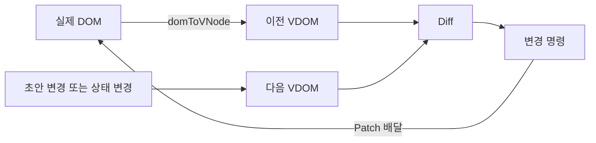

# Mini React · Node World

Vanilla JavaScript로 **DOM → Virtual DOM → Diff → Patch**와 **함수형 컴포넌트·Hooks**를 구현한 학습 프로젝트입니다. Node World에서 이전·다음 VDOM을 노드 캐릭터로 비교하고, Patch 배달부가 변경 명령을 실제 DOM에 적용하는 과정을 관찰합니다.

이 문서는 `origin/JSZeroDev/react`의 README 구성을 바탕으로 현재 프로젝트의 화면, 구현 계약, 검증 결과에 맞춰 작성했습니다. 참조 브랜치의 장바구니 UI나 테스트 결과를 현재 프로젝트의 결과로 사용하지 않습니다.

## 1. 현재 구현 상태와 발표 흐름

현재 진입 화면은 **Node World 하나**입니다. 왼쪽 메뉴와 별도 실습 페이지는 제거했으며, 기존 실습 모듈 일부는 저장소에 남아 있습니다.

Phase 1은 DOM 변환, VDOM 렌더, Diff·Patch, key 기반 이동을 구현했습니다. Phase 2는 FunctionComponent와 useState·useEffect·useMemo, 상태 갱신 배칭을 같은 Diff·Patch 엔진에 연결했습니다. 아래 자동 검증 결과에는 통과한 검사와 남은 실패를 함께 기록했습니다.

### 발표 시연 순서

1. **DOM 읽기**: 현재 실제 DOM을 읽어 이전 VDOM을 만듭니다.
2. **텍스트·속성 변경 / 친구 추가·삭제 / 교체·이동**: 다음 VDOM 초안을 만듭니다. 단계별 모드의 대상 DOM은 아직 바뀌지 않습니다.
3. **비교 시작**: 이전·다음 노드 캐릭터를 대응시키며 실제 Diff가 만든 변경 명령을 수집합니다.
4. **Patch 배달부**: 변경 명령을 실제 DOM에 적용하고 유지·생성·삭제된 요소를 확인합니다.
5. **State +3**: 실제 Hook의 상태 갱신, 배칭, Memo 계산, Effect·cleanup 기록을 확인합니다.



같은 입력 자동 적용 모드에서는 Diff·Patch를 바로 실행하고 캐릭터 애니메이션으로 변화를 보여줍니다. 캐릭터의 이동 시간과 Patch 대기 시간은 학습 연출입니다.

## 2. 요구사항과 구현 근거

| 요구사항                    | 구현 위치                                      | 검증 근거                                          |
| --------------------------- | ---------------------------------------------- | -------------------------------------------------- |
| 실제 DOM → VDOM             | `src/vdom/dom-to-vnode.js`                     | 중첩 구조·공백·주석·현재 폼 값 변환 테스트         |
| VDOM → 실제 DOM             | `src/vdom/render.js`                           | 왕복 변환, 텍스트 처리, 속성·이벤트 렌더 테스트    |
| 이전·다음 VDOM 비교         | `src/vdom/diff.js`                             | 변경 없음, 텍스트·속성·추가·삭제·교체 테스트       |
| 변경된 실제 DOM만 갱신      | `src/vdom/patch.js`                            | 결과 트리와 기존 DOM 객체 참조 검증                |
| key를 이용한 목록 이동      | `diff.js`, `patch.js`                          | 이동·추가·삭제·교체 혼합 및 회귀 테스트            |
| 함수형 컴포넌트와 상태 유지 | `src/runtime/function-component.js`            | 재실행 상태 보존, 독립 루트, Hook 호출 규칙 검사   |
| useState·useMemo·useEffect  | `src/runtime/hooks.js`                         | setter·의존성·캐시·Effect 실행 순서·cleanup 검사   |
| Phase 1·2 통합              | `FunctionComponent.update()`                   | 상태 변경 → 컴포넌트 실행 → 새 VDOM → Diff → Patch |
| 사용자 조작과 시각화        | `src/characters/journey.js`, `journey-view.js` | 읽기·초안·비교·배달 단계와 실제 DOM 적용 통합 검사 |
| Vanilla JavaScript 사용     | `package.json`, `src/`                         | React/Vue 런타임 의존성 없음                       |

이력 모듈은 불변 스냅샷, 이동 경계, 뒤로 이동 후 새 저장 시 미래 이력 제거를 지원합니다. 기존 자유 HTML 편집 화면은 현재 메인 페이지에 마운트하지 않습니다.

## 3. Phase 1 · DOM과 VDOM 비교·적용

### 실제 엔진과 캐릭터의 관계

`journey.js`가 실제 DOM 읽기와 초안 변경, `diff()`·`patch()` 실행을 조율합니다. `diff-trace.js`가 노드 대응과 방문 순서를 시각화하고, `journey-view.js`가 캐릭터를 그립니다. 단계별 모드에서는 비교 중에 대상 DOM을 바꾸지 않고, 배달 시점에 실제 Patch를 실행합니다.

| 변경 명령 | 실제 동작                    | 기존 DOM 재사용         |
| --------- | ---------------------------- | ----------------------- |
| TEXT      | Text 노드의 내용 변경        | 재사용                  |
| PROPS     | 속성·폼 프로퍼티·이벤트 변경 | 재사용                  |
| INSERT    | 새 노드 삽입                 | 삽입한 노드만 새로 생성 |
| REMOVE    | 대상 노드 제거               | 다른 노드는 유지        |
| REPLACE   | 대상과 하위 트리 교체        | 교체 대상은 새로 생성   |
| MOVE      | 같은 노드를 다른 위치로 이동 | 재사용                  |

TEXT·PROPS에서 캐릭터 버전이 바뀌어도 실제 DOM 객체는 유지됩니다. 부모의 타입이나 태그가 달라 REPLACE가 결정되면 자식 비교는 종료합니다. 새 부모의 하위 트리가 함께 만들어지므로 자식별 수정 명령을 별도로 적용할 필요가 없기 때문입니다.

### 목록의 key와 경로

이전·다음 형제 목록 모두에 고유한 `props.key`가 있으면 같은 key의 노드를 대응시키고 MOVE를 만들 수 있습니다. key가 없거나 일부에만 있거나 중복되면 인덱스로 비교합니다. 이 계약은 참조 브랜치의 `data-key` 정책과 다릅니다.

Patch 경로는 텍스트를 포함하고 주석을 제외한 자식 순서를 사용합니다. MOVE는 변경 전 경로와 최종 위치를 기록합니다. Patch는 구조를 바꾸기 전에 대상 참조를 확보해 연속 삭제나 이동 뒤에도 올바른 노드를 수정합니다.

### VDOM 없이 전체를 다시 만드는 비교 화면

상단 비교 영역의 `direct-render.js`는 일반 데이터로 새 DOM 목록을 만들고 전체 하위 트리를 교체합니다. Node World의 Patch 대상과는 별도의 DOM입니다. 같은 상태 변경에서 전체 생성과 부분 갱신의 차이를 관찰하며, 이 화면의 애니메이션으로 실행 속도를 비교하지 않습니다.

## 4. Phase 2 · 상태와 Hooks

런타임의 최초 mount는 `render()`로 DOM을 생성합니다. 이후 상태 변경은 기존 VDOM과 다음 VDOM을 `diff()`하고 `patch()`합니다. 갱신마다 전체 DOM을 재생성하는 방식으로 Phase 1을 우회하지 않습니다.

```text
setState → 갱신 예약 → 함수형 컴포넌트 재실행
         → 다음 VDOM → Diff → Patch → Effect 실행
```

| 기능              | 구현 방식                                | 확인할 내용                                          |
| ----------------- | ---------------------------------------- | ---------------------------------------------------- |
| FunctionComponent | 인스턴스에 hooks·이전 VDOM·DOM 루트 보관 | 컴포넌트 재실행 뒤 상태 유지                         |
| useState          | Hook 슬롯에 값과 setter 저장             | 값·함수형 setter, 같은 값 갱신 생략                  |
| useMemo           | 계산 결과와 의존성 저장, Object.is 비교  | 같은 의존성은 재사용, 변경 시 재계산                 |
| useEffect         | DOM commit 후 실행할 Effect 수집         | 의존성 변경 시 이전 cleanup 후 실행, unmount cleanup |
| 배칭              | microtask에 갱신을 예약                  | 같은 동기 작업의 여러 setter를 한 번의 갱신으로 처리 |

Node World의 **State +3**은 별도 컨테이너의 실제 함수형 루트를 실행해 다음 VDOM 초안을 만듭니다. 이 루트의 commit과 Effect 기록은 먼저 발생하고, 메인 대상 DOM은 별도 비교·Patch 배달 단계에서 변경됩니다. 두 DOM의 적용 시점을 구분해서 설명해야 합니다.

Hook은 루트 함수형 컴포넌트의 최상위에서 같은 순서로 호출합니다. 순수 자식은 props를 받으며, 자식별 독립 Hook 상태와 React 전체 스케줄러는 구현 범위에 포함하지 않습니다.

## 5. 테스트 범주와 검증 방법

Vitest와 jsdom으로 입력, 변경 명령, 최종 DOM, 기존 노드 참조를 검사합니다. 소스에 테스트가 있는 것과 현재 검사에 통과한 것은 구분합니다.

| 테스트 범주      | 검사 내용                                                  | 테스트 파일 (`tests/`)                                                   |
| ---------------- | ---------------------------------------------------------- | ------------------------------------------------------------------------ |
| DOM 변환·렌더    | 중첩 구조·공백·현재 폼 값·왕복 변환                        | `dom-to-vnode.test.js`, `render.test.js`                                 |
| Diff 명령        | 텍스트·속성·추가·삭제·부모 교체·입력 불변성                | `diff.test.js`                                                           |
| Patch·DOM 보존   | 연속 삭제·중간 삽입·루트 교체·이벤트·폼 프로퍼티·참조 유지 | `patch.test.js`                                                          |
| key 목록 회귀    | 이동과 하위 변경, 빈 목록, 재정렬·교체 혼합                | `keyed-diff.regression.test.js`, `keyed-patch.regression.test.js`        |
| 상태·Memo·Effect | 상태 보존·배칭·의존성·캐시·cleanup·Hook 호출 오류          | `hooks.test.js`, `runtime-lifecycle.regression.test.js`                  |
| 이력 관리        | 경계·불변 스냅샷·새 저장 후 이력 분기                      | `history.test.js`                                                        |
| Node World 통합  | 읽기·초안·Diff·배달·중복 적용 방지·예약 작업 정리          | `journey.test.js`, `bootstrap.test.js`                                   |
| 비교·캐릭터 관찰 | 노드 대응·부분 갱신·애니메이션 상태·기록 분리              | `comparison.test.js`, `characters.test.js`                               |
| 기능·학습 모듈   | 추가·검색·완료·삭제, 단계별 실행과 내장 엔진 검사          | `demo.test.js`, `learning.test.js`, `proof.test.js`, `self-test.test.js` |
| 기존 편집 화면   | HTML 입력 정책·Patch·이력 이동                             | `playground.test.js`                                                     |

핵심 성질은 다음과 같습니다. Patch 뒤 트리가 다음 VDOM과 같은지뿐 아니라 변경되지 않은 DOM 객체를 재사용했는지도 확인합니다.

```text
domToVNode(patch(render(previous), diff(previous, next))) ≈ next
```

`patch.test.js`에서는 고정된 난수로 만든 150개 트리 쌍에도 이 성질을 검사합니다. 이는 150개의 별도 테스트 항목이 아니라 한 테스트 안의 반복 검증입니다.

### 실제 확인 기록 · 2026-11-11

| 검사                            | 결과와 해석                                                          |
| ------------------------------- | -------------------------------------------------------------------- |
| `npm test`                      | 18개 파일 중 14개 통과·4개 실패, 111개 테스트 중 96개 통과·15개 실패 |
| Node World·Diff·Patch 집중 검사 | 직전 구현 검증에서 3개 파일·36개 테스트 통과                         |
| 브라우저 수동 검증              | 이번 문서 작업에서 수행하지 않음                                     |

현재 실패는 캐릭터 구 화면 관련 6개, 기존 편집 화면 관련 7개, Node World 마운트 선택자 1개, Hook unmount 계약 1개입니다. 구 화면을 기대하는 테스트와 현재 단일 화면 구성이 맞지 않는 문제가 있으며, Hook unmount 기대값도 구현과 일치시키는 검토가 필요합니다. 전체 검증이 통과한 상태로 표시하지 않습니다.

jsdom의 포커스·선택 범위 테스트는 실제 브라우저의 레이아웃, 한글 IME, 애니메이션 가독성을 보장하지 않습니다. 발표 전 [수동 점검 문서](docs/MANUAL_TESTS.md)를 참고해 조작 흐름과 좁은 화면에서의 표시를 확인합니다.

## 6. 실행 환경과 명령

지정 환경은 Node.js 24.x와 npm입니다. 이번 확인 환경은 Windows / Node.js `v24.14.0` / npm `11.9.0`입니다. Vite는 개발·빌드, Vitest는 테스트, jsdom은 테스트용 DOM, Prettier는 포맷 검사에 사용합니다. API 서버·데이터베이스·별도 환경변수는 필요하지 않습니다.

```sh
npm ci
npm run dev
```

터미널에 표시된 주소로 접속합니다. 이미 의존성이 설치되어 있다면 `npm run dev`부터 실행할 수 있습니다.

| 명령                 | 용도                  |
| -------------------- | --------------------- |
| `npm run dev`        | 개발 서버             |
| `npm test`           | 전체 자동 테스트      |
| `npm run test:watch` | 변경 시 테스트 재실행 |

## 7. 디렉터리와 모듈 계약

```text
src/
  main.js                         앱 진입점
  bootstrap.js                    단일 Node World 초기화
  characters/
    journey.js                    실제 DOM·VDOM·Diff·Patch 흐름
    journey-view.js                트리·캐릭터·조작 화면
    diff-trace.js                  노드 대응과 비교 방문 순서
    direct-render.js               전체 DOM 재생성 비교 화면
  vdom/                           DOM 변환·렌더·Diff·Patch
  runtime/                        함수형 컴포넌트·Hooks
  history/                        VDOM 스냅샷 이력
  playground/                     기존 Phase 1 실습 모듈
  demo/                           기존 Phase 2 데모 모듈
tests/                            단위·회귀·통합 테스트
docs/                             설계·학습·수동 점검 문서
```

| API                                  | 계약                                                         |
| ------------------------------------ | ------------------------------------------------------------ |
| `domToVNode(node)`                   | 실제 DOM을 VNode로 읽음                                      |
| `render(vnode)`                      | 새 DOM 노드를 생성해 반환                                    |
| `diff(previous, next)`               | 변경 명령 배열 반환                                          |
| `patch(root, patches)`               | 변경 적용 후 루트 반환. 루트가 바뀔 수 있어 반환값 보관 필요 |
| `FunctionComponent.mount(container)` | 최초 DOM 생성과 컴포넌트 루트 연결                           |
| `FunctionComponent.update()`         | 새 VDOM 생성·Diff·Patch·Effect 실행                          |

VDOM은 텍스트 `{ type: 'text', value }` 또는 요소 `{ type: 'element', tag, props, children }`입니다. 핵심 엔진은 화면의 버튼이나 애니메이션을 알지 않으며, 화면이 엔진을 호출합니다. 자세한 계약은 [설계 문서](docs/ARCHITECTURE.md)와 `src/vdom/types.js`에 정리되어 있습니다.

## 8. 구현 범위와 AI 활용

React의 Fiber·동시 렌더링·SSR·Portal·전체 React API는 구현하지 않습니다. 최소 이동 횟수나 모든 트리 형태에서의 O(n) 갱신을 보장하지 않으며, 메모리 사용량과 Reflow·Repaint 횟수도 측정하지 않습니다.

AI를 코드·테스트·문서 초안과 검토에 활용했습니다. 사용자가 제안한 캐릭터 이동, 두 VDOM 비교, Patch 배달, 단일 화면을 실제 엔진 호출과 연결했습니다. 발표에서는 애니메이션의 연출, 실제 엔진 실행, 자동 검증의 통과 범위와 남은 실패를 구분해 설명합니다.
