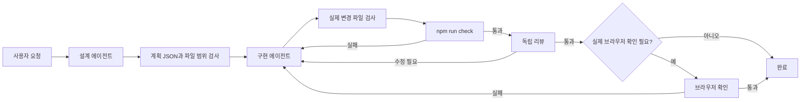

# Mini React AI 개발 워크플로

Mini React의 개발 작업을 구현, 자동 검사, 독립 리뷰로 나눈다. 검사와 리뷰에서 발견한 문제는 근거와 함께 구현 단계로 돌려보낸다.



1. **작업 정의 및 재현.** 기대 동작, 재현 절차, 작업 범위를 기록한다. 기존 코드가 이미 성공 조건을 만족하면 확인 근거를 기록한다. 재현이나 검증에 필요한 정보가 없으면 무엇이 필요한지 남기고 멈춘다.
2. **구현.** 변경 범위 내에서 수정하고 관련 테스트로 동작을 확인한다.
3. **검증.** `npm run check`를 실행해 포맷, Vitest, 빌드를 확인한다. 검사 실패 시 로그를 구현 담당에게 전달한다. 실행 환경이 문제라면 환경을 먼저 확인한다.
4. **리뷰.** 검증을 통과한 변경을 별도 리뷰어가 성공 조건과 비교한다. 수정이 필요한 문제는 파일과 줄, 조건, 영향을 전달한다. 수정 후에는 검증부터 다시 진행한다.
5. **브라우저 확인.** 포커스, 키보드, IME 등 실제 브라우저 확인이 성공 조건이면 [수동 검증 절차](MANUAL_TESTS.md)를 참고해 확인한다. 확인이 남아 있으면 완료 대신 `NEEDS_BROWSER_CHECK`로 기록한다.

최초 구현 이후 재수정은 최대 다섯 번이다. 중단 시 최근 검사 로그나 리뷰 결과를 남긴다.

## Codex 앱에서 실행

프로젝트 전용 서브에이전트는 [탐색 담당](../.codex/agents/mini_react_explorer.toml)과 [리뷰 담당](../.codex/agents/mini_react_reviewer.toml)이다. 각 TOML의 `name`이 호출 이름이고 `developer_instructions`가 역할별 지시다. 둘 다 모델과 권한을 부모 세션에서 상속하며, 역할 지시에서 파일을 수정하지 않도록 한다. 메인 에이전트가 구현과 단계 진행을 맡는다.

프로젝트 폴더를 `Mini_React`로 열고 아래 양식을 실제 이슈로 채운다. 기존 변경이 있는 폴더라면 이번에 수정할 파일과 리뷰할 범위를 함께 지정한다.

```text
docs/AI_WORKFLOW.md에 따라 아래 작업을 진행해줘.

작업과 재현 절차: …
성공 조건: …
수정 및 리뷰 범위: …

원인이 불분명하면 mini_react_explorer 서브에이전트에게 실행 경로와 재현 절차를 찾아달라고 해줘.
구현은 메인 에이전트가 맡고, npm run check가 통과하면 mini_react_reviewer 서브에이전트를
호출해 이번 변경을 검토시켜줘. 결과를 기다린 뒤 워크플로 규칙에 따라 진행해줘.
거친 단계, 실제 검사 결과, 리뷰 결과, 브라우저 확인 여부를 기록해줘.
```

서브에이전트가 호출되면 앱의 채팅에 해당 작업이 표시된다. 설정만 확인하려면 새 채팅에서 `mini_react_explorer 서브에이전트를 호출해서 src/runtime의 진입점과 관련 테스트를 찾아줘. 파일은 수정하지 마.`라고 요청한다.

채팅에서 사용자 정의 역할을 이름으로 선택할 수 없다고 나오면 `기본 서브에이전트 한 명을 호출해줘. 작업을 넘길 때 .codex/agents/mini_react_explorer.toml의 developer_instructions를 함께 전달하고, src/runtime의 진입점과 관련 테스트를 찾아달라고 해줘.`라고 요청한다. 이 방식은 역할 지시를 직접 전달한다. 리뷰에는 `mini_react_reviewer.toml`의 지시를 같은 방식으로 전달한다.

## PowerShell에서 자동 실행

PowerShell 7.4 이상, Node.js 24, 로그인된 Codex CLI가 필요하다. 의존성이 없으면 `npm ci`로 설치한다. 쓰기 실행은 이 설정과 작업 기준점이 커밋되어 있고 `git status --short`가 비어 있는 브랜치나 worktree에서 시작한다. 현재 작업 중인 변경까지 기준에 넣으려면 먼저 해당 변경을 의도한 기준 커밋에 포함한다.

```powershell
pwsh -NoProfile -File ./scripts/Invoke-AiWorkflow.ps1 -DryRun -Task '작업과 성공 조건'
pwsh -NoProfile -File ./scripts/Invoke-AiWorkflow.ps1 -PlanOnly -Task '작업과 성공 조건'
pwsh -NoProfile -File ./scripts/Invoke-AiWorkflow.ps1 -Task '작업과 성공 조건'
```

`-DryRun`은 단계와 입력만 보여준다. `-PlanOnly`는 현재 파일을 읽어 계획 JSON만 만든다. 작업 트리에 진행 중인 수정이 있어도 실행할 수 있다. 전체 실행은 기준점에서 `npm run check`를 먼저 돌린다.

설계, 구현, 리뷰를 각각 별도 `codex exec` 세션에서 실행한다. 설계와 리뷰에 읽기 전용 샌드박스를 적용한다. 설계는 수정 가능 파일과 관찰할 성공 조건을 JSON으로 반환한다. 실행기가 계획을 검사하고 같은 계획을 구현과 리뷰에 전달한다. 리뷰는 사용자 요청과 계획을 함께 확인한다.

자동 구현 범위는 `src/`, `tests/`, `index.html`의 계획에 명시된 파일이다. 실행기는 구현과 검사 후 Git에 잡히는 변경을 비교한다. 범위 밖 파일, 기준 커밋 변경, 스테이징 변경이 감지되면 중단하고 변경을 확인할 수 있도록 남긴다. 이 검사는 작업 후 Git 변경을 기준으로 하며, 구현 세션 자체는 작업 폴더 쓰기 권한을 갖는다. `npm run check`의 종료 코드와 리뷰 JSON으로 재시도 여부를 결정한다. 범위를 바꿔야 하면 새 작업으로 설계부터 시작한다.

- `-MaxRetries`는 0부터 5까지 지정할 수 있다. 기본값은 재수정 다섯 번이다. `-MaxRetries 0`이면 최초 구현만 시도한다.
- `-BrowserCheck`를 붙이거나 리뷰가 실제 브라우저 확인을 요구하면 자동 단계 통과 후 `NEEDS_BROWSER_CHECK`와 종료 코드 `2`를 반환한다. 브라우저는 별도로 확인한다.
- `DONE`은 종료 코드 `0`이다. 중단이나 재시도 한도 도달은 오류로 표시한다. 변경 파일은 작업 트리에, 검사 로그와 리뷰 JSON은 실행 시 표시한 임시 폴더에 남는다.
